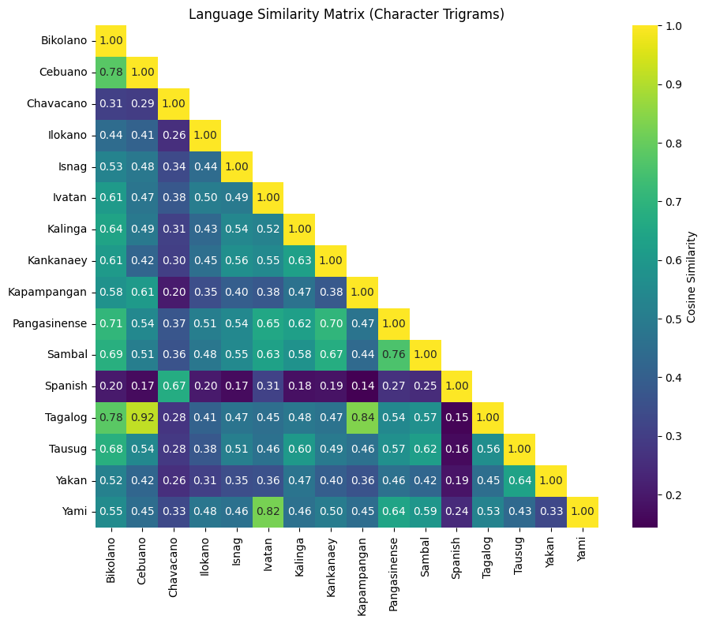
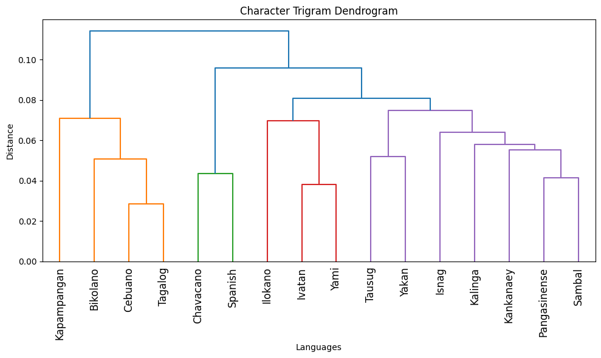

# Philippine-language clustering

An exploratory project for NLP1000 (Introduction to Natural Language Processing). This repository is retained as a course showcase. Publication revival and a new research pipeline are not planned.

## What the implementation does

The main notebook represents 16 corpus entries with character trigrams and word unigrams, reduces their feature matrices with SVD, and explores agglomerative clustering and cosine similarity. The entries include Spanish as a reference and Yami/Tao from Orchid Island, Taiwan; they should not all be described as 16 Philippine languages.

The notebook requests 50 SVD components, but `src/modeling.py` caps this at the smaller of the requested count, samples minus one, and features minus one. With 16 entries, this is at most 15 components. Silhouette scores help explore cluster counts on this same small sample; they do not independently validate language families or demonstrate stable linguistic classifications.




## Geographic comparison and corrections

The geographic comparison excludes Spanish and uses one manually chosen location for each of 15 entries. It computes **Spearman rank correlation between geographic distance and orthographic cosine similarity** across 105 upper-triangle pairs. It does not implement a Mantel test. A negative coefficient describes lower similarity at greater distance in these representations; it is not a correlation between two distance matrices.

Pairs share languages and are dependent. Ordinary pair-level Spearman p-values do not establish inferential significance here. The notebook now reports the descriptive coefficient without that p-value; no replacement significance test or new experiment has been added. Earlier Mantel and significance claims are withdrawn for this showcase.

The historical geographic scatterplot is withdrawn: its embedded Mantel, Pearson, p-value, and distance labels do not describe this implementation. No replacement result or figure is asserted.

This correction describes the repository implementation. It does not amend or certify an external course-paper copy that was not available for this review.

## Corpus provenance and limits

The course used segmented Bible translations supplied as `segmented.zip` through the [course input folder](https://drive.google.com/drive/folders/1hKNLOayge7rvjx5LNMzHrMoGJY7gTeAT?usp=sharing). The notebooks load `segmented/by_sentence/`. The repository does not provide a verified manifest of translation editions, acquisition dates, source versions, or reuse permissions. Availability of that external folder is not guaranteed.

Book coverage differs across translations, and the frequency features are not built from an aligned verse intersection. Differences can reflect coverage, translation style, and orthography as well as language relationships. One provincial/island point cannot represent a language's full distribution or contact history. There is no stability analysis, independent family validation, or basis for causal geographic claims.

The original translation texts are not redistributed here. Public availability does not establish permission to redistribute them; resolve edition-specific terms before obtaining or sharing inputs. No repository-wide data license or research novelty claim is asserted.

## Running the coursework

Use Python 3.13 and the dependencies in `pyproject.toml`:

```bash
git clone https://github.com/qu1r0ra/philippine-language-clustering.git
cd philippine-language-clustering
uv sync
```

Obtain the permitted course inputs separately, then open `notebooks/philippine_language_clustering.ipynb` with the root `.venv` kernel. Its setup cell is for Colab; skip that cell locally. `notebooks/language_map_clustering.ipynb` is a small exploratory companion, not a separate validation study. Committed figures are historical coursework outputs; a fresh end-to-end reproduction requires the external corpus and may depend on package versions. This correction did not rerun the corpus analysis.
